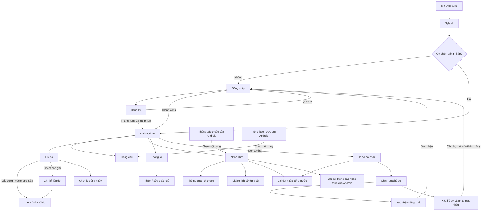

# Vita — Đặc tả hiện trạng sản phẩm để bàn giao Figma

> **Ảnh chụp lịch sử ngày 19/10/2026:** tài liệu này được lập trước khi chức năng thời tiết/AQI và giấc ngủ bị gỡ khỏi ứng dụng. Các phần mô tả hai chức năng đó chỉ lưu dấu thiết kế cũ, không thuộc phạm vi ViTa hiện tại. Khi có khác biệt, mã nguồn Android hiện tại và các quyết định mới hơn được ưu tiên.

Ngày khảo sát: 19/10/2026. Phạm vi: mã nguồn Android hiện có trong `Vita_Project`, đọc tĩnh; không chạy ứng dụng, build hoặc kiểm thử thiết bị. “Đã xác nhận” nghĩa là thấy luồng xử lý trong code và tài nguyên liên quan, không phải xác nhận hoạt động trên mọi thiết bị.

Tài liệu kiểm kê hiện trạng, không phải đề xuất thiết kế mới. Mã nguồn được ưu tiên hơn tên file, bình luận hoặc thông điệp UI khi có khác biệt. Mỗi mã nguồn **[A…]**, **[F…]**, **[D…]**, **[U…]**, **[R…]** được ánh xạ tới đường dẫn chính xác ở mục 9; tên phương thức/resource đi kèm cho phép đối chiếu từng kết luận.

## 1. Tóm tắt sản phẩm

### 1.1. Nhu cầu và phạm vi

Vita là ứng dụng ghi nhận sức khỏe cá nhân: lưu các lần đo thủ công, theo dõi BMI, nước uống và giấc ngủ; đặt lịch nhắc thuốc/nước; xem xu hướng và thời tiết theo thành phố. Nội dung tiếng Việt và slogan “Sức sống mỗi ngày, an tâm tại nhà” thể hiện định hướng chăm sóc hằng ngày tại nhà. Chưa có căn cứ trong code để xác định chính xác nhóm tuổi mục tiêu hoặc người dùng có bệnh cụ thể. [R1: `splash_slogan`, `nav_*`; A1–A10; F1–F4]

Tài khoản và nhật ký được lưu tại thiết bị bằng SQLite, phiên đăng nhập và một số tùy chọn/cache dùng SharedPreferences. Có nhiều hồ sơ đăng ký trên cùng cơ sở dữ liệu; một phiên hiện hành tại một thời điểm. Không thấy triển khai đăng nhập máy chủ, đồng bộ đám mây, chia sẻ với bác sĩ, đặt lịch khám, quên/đổi mật khẩu hoặc nhập số đo bằng cảm biến trong mã nguồn chính đã khảo sát. [D1–D6; U1; N1]

### 1.2. Nền tảng đã xác minh

| Hạng mục | Hiện trạng trong dự án | Căn cứ |
|---|---|---|
| Module | Một module Android application `:app`, namespace/application ID `vn.edu.tdmu.vita` | B1, B2 |
| Ngôn ngữ ứng dụng | Java; cấu hình Gradle Kotlin DSL; Java source/target 17 | B1; A1–A10, F1–F4 |
| UI | Android Views/layout XML, AppCompat Activity, Fragment, RecyclerView, Material Components | B1; R2; A4 |
| SDK khai báo | minSdk 24, targetSdk 34, compileSdk 36 | B1 |
| Thư viện | Material 1.14.0, AppCompat 1.8.0, ConstraintLayout 2.2.2; MPAndroidChart 3.1.0 | B1, B3 |
| Cấu trúc | Activity/Fragment xử lý UI và gọi DAO; model; SQLiteOpenHelper; utility; receiver; client mạng | D1; A1–A10; F1–F4; N1 |
| Theme | `Theme.Material3.Light.NoActionBar`; API 29+ tắt force dark | R3, R4 |
| Biểu đồ | 4 LineChart và 2 BarChart | F4; R2 `fragment_stats.xml` |
| Mạng | HttpURLConnection gọi Open-Meteo trên executor nền; kết quả trả về luồng UI, cache theo thành phố | N1 |
| Nhắc nhở | AlarmManager, BroadcastReceiver, notification kênh thuốc/nước; BOOT_COMPLETED | M1; E1–E4; U10 |

Đây là cấu hình đọc từ file, chưa xác minh khả năng resolve/build của các phiên bản thư viện. Báo cáo không đánh giá tính đúng đắn y khoa của các ngưỡng phân loại; các ngưỡng dưới đây mô tả hành vi ứng dụng. [B1, B3; U3, U4, U5]

## 2. Sơ đồ điều hướng

Các nhánh liền dưới đây đều được xác nhận trong code. Không thêm nhánh suy đoán vào sơ đồ. [A1–A10; F1–F4; U10]

MainActivity mặc định mở Trang chủ; intent `EXTRA_TAB=TAB_REMINDER` mở Nhắc nhở. Chuyển tab tạo Fragment mới bằng `replace`, không thêm vào fragment back stack. Chọn lại tab hiện tại không làm gì. Không suy diễn rằng bộ lọc ngày hoặc lựa chọn 30 ngày được giữ sau khi đổi tab: HealthFragment lưu khoảng lọc vào instance state nhưng MainActivity không có cơ chế giữ riêng từng tab; StatsFragment khởi tạo `rangeDays=7`. [A4: `openTab`, `onNewIntent`, `onTabSelected`; F2, F4]

Các màn hình/form con có nút quay lại gọi `finish()`. Lưu form thành công trả về màn hình gọi và tải lại dữ liệu theo callback hoặc `onResume`. Không thấy dialog xác nhận bỏ thay đổi khi rời form. [A3, A5–A10; F2–F4]

## 3. Danh mục màn hình

Quy ước: S01–S14 là các ngữ cảnh màn hình cần bàn giao. MainActivity là khung dùng chung; màn hình thêm/sửa dùng chung Activity nhưng có tiêu đề và dữ liệu khác nhau. “Trạng thái” chỉ liệt kê trạng thái có căn cứ; chưa có spinner tải cho các thao tác SQLite đồng bộ.

### S01 — Khởi động / Splash

- **Nguồn:** [A1] `SplashActivity.checkSessionAndNavigate`; [R2] `activity_splash.xml`; [R1] `splash_*`.
- **Điểm vào:** launcher trong Manifest [M1].
- **Nội dung:** logo Vita, tên app, slogan, dòng phiên bản/trường. Khối thương hiệu fade-in 600 ms; sau khoảng 1.200 ms kiểm tra phiên.
- **Dữ liệu/hành vi:** `SessionManager.isLoggedIn()` quyết định mở MainActivity hay LoginActivity; kết thúc Splash.
- **Trạng thái/đi tiếp:** một trạng thái thương hiệu; nhánh chuyển tiếp có/không phiên. Không có onboarding nhiều trang hoặc thao tác người dùng trên Splash.

### S02 — Đăng nhập

- **Nguồn:** [A2] `handleLogin`, `setupListeners`; [D2] `login`; [R2] `activity_login.xml`; [R1] `login_*`.
- **Điểm vào:** Splash khi chưa có phiên; sau đăng xuất/xóa hồ sơ.
- **Thành phần:** logo, tiêu đề/phụ đề, tên đăng nhập, mật khẩu có toggle hiển thị trong XML, nút Đăng nhập, liên kết Đăng ký.
- **Dữ liệu:** đối chiếu tài khoản SQLite; trường đầu vào được trim. Thành công lưu phiên và xóa task cũ để vào MainActivity, toast chào theo họ tên hoặc username.
- **Hành động:** nhập/sửa hai trường; bấm đăng nhập; sang đăng ký.
- **Trạng thái:** mặc định; thiếu username; thiếu mật khẩu; thông tin không khớp (lỗi tại ô mật khẩu); thành công. Nhập lại xóa lỗi của trường tương ứng. Không thấy trạng thái gọi mạng/đang tải riêng.

### S03 — Đăng ký

- **Nguồn:** [A3] `handleRegister`; [D2] `register`; [U2]; [R2] `activity_register.xml`; [R1] `register_*`.
- **Điểm vào:** liên kết ở Đăng nhập; toolbar hoặc liên kết đã có tài khoản quay lại.
- **Thành phần:** nhóm thông tin đăng nhập (username, password, xác nhận), nhóm thể chất (họ tên, năm sinh, dropdown giới tính, chiều cao, cân nặng), nút hoàn tất.
- **Bắt buộc:** username, password, xác nhận, chiều cao và cân nặng. Họ tên/năm sinh có thể trống; giới tính Nam/Nữ/Khác, mặc định Nam.
- **Quy tắc:** username ≥3 ký tự, không chứa dấu cách; password sau trim ≥6; xác nhận khớp. Giới hạn thể chất/năm sinh ở mục 6.
- **Kết quả:** tạo user với mục tiêu nước 2.000 ml/ngày, BMI ASIAN; mặc định model: khung 07:00–22:00, 250 ml/lần, không có giờ riêng và điều chỉnh thời tiết tắt. Lưu phiên, toast, vào MainActivity; không bắt đăng nhập lại. [A3; D2; model `User`]
- **Trạng thái:** form chưa nhập; lỗi từng trường; tên tài khoản trùng; thành công. Giá trị register trả `-1` được UI hiển thị thành lỗi username đã tồn tại, kể cả nguyên nhân lưu khác — cần giữ ghi chú này khi đặc tả lỗi.

### S04 — Khung chính và Trang chủ

- **Nguồn:** [A4]; [F1] `loadBmiCard`, `fetchWeather`, `renderWeather`; [N1]; [U3, U6]; [R2] `activity_main.xml`, `fragment_home.xml`; [R1].
- **Điểm vào:** MainActivity sau xác thực hoặc mở app với phiên; tab Trang chủ; chạm nội dung notification nước.
- **Khung chung:** toolbar tên tab và icon hồ sơ; bottom nav Trang chủ / Chỉ số / Nhắc nhở / Thống kê.
- **Nội dung:** lời chào theo giờ và tên; card BMI (giá trị, nhãn phân loại, chiều cao/cân nặng, nguồn cân nặng ban đầu nếu dùng, chuẩn đánh giá/phạm vi tuổi); card thời tiết với dropdown thành phố, nhiệt độ, độ ẩm, AQI/nhãn chất lượng, thời gian cập nhật, nhãn ngoại tuyến; card gợi ý chăm sóc hôm nay.
- **BMI:** cân nặng của bản ghi gần nhất có cân nặng; chưa có thì dùng cân nặng ban đầu, cùng chiều cao/chuẩn/năm sinh trong hồ sơ. Không giả định dữ liệu là đo hôm nay. Quy tắc tuổi ở mục 6. [D3 `getLatestWeight`; U3]
- **Thời tiết:** chọn TP. Hồ Chí Minh, Bình Dương, Hà Nội, Đà Nẵng hoặc Cần Thơ; lưu lựa chọn trên thiết bị. Không dùng GPS hay xin quyền vị trí. Dữ liệu nhiệt độ/độ ẩm và US AQI lấy từ Open-Meteo; AQI lỗi vẫn có thể hiển thị thời tiết. [N1; M1]
- **Gợi ý:** nhiệt độ ≥33°C tạo lời nhắc trời nóng; AQI >100 thêm lời nhắc không khí; tùy chọn điều chỉnh nước có thể cộng 300 ml cho hôm nay (mục 6). Nếu không rơi vào điều kiện nào thì dùng nội dung chăm sóc chung. Đây là nội dung theo quy tắc, không thấy gọi mô hình AI. [F1; U6; R5]
- **Trạng thái:** BMI đầy đủ; chỉ số tham khảo do thiếu/ngoài phạm vi tuổi; thiếu số đo `--`; đang tải thời tiết (`--`, lời “Đang tải…”); dữ liệu trực tuyến; fallback cache đúng thành phố kèm Ngoại tuyến/thời điểm; AQI không có; không có mạng/cache thì toast và lời chưa có dữ liệu. Không thấy nút retry/refresh độc lập; đổi thành phố phát sinh tải mới. [F1, N1]

### S05 — Chỉ số / Nhật ký sức khỏe

- **Nguồn:** [F2] `loadData`, `showDateFilterPicker`, `updateEmptyState`, `onContextItemSelected`; [D3]; [AD1]; [R2] `fragment_health.xml`, `item_health_record.xml`; [R1] `health_*`.
- **Điểm vào:** tab Chỉ số.
- **Thành phần:** tiêu đề nhật ký, nút “Tất cả ngày”/khoảng đã chọn, “Xem tất cả” khi có lọc, danh sách card, empty state và FAB thêm.
- **Mỗi card:** ngày/giờ đo (hoặc “Chưa ghi giờ”), bối cảnh đường huyết nếu có đường huyết; các giá trị hiện hữu: huyết áp + badge khi đủ cặp, cân nặng, nhịp tim, đường huyết. Thiếu giá trị thì ẩn thành phần. Ghi chú không hiển thị nội dung ở card; có ở chi tiết. [AD1; U7]
- **Dữ liệu:** `HealthDao`, theo user; mới nhất trước theo ngày, giờ, ID. Lọc dùng MaterialDatePicker chọn khoảng đầu/cuối và truy vấn bao gồm cả hai ngày; đảo thứ tự kết quả để mới nhất trước.
- **Hành động:** chạm card → S07; FAB → S06 thêm; nhấn giữ → menu Sửa/Xóa; sửa → S06; xóa → dialog ngày bản ghi, Hủy bỏ/Xóa. Xóa thành công cập nhật list và toast; thất bại toast.
- **Trạng thái:** có dữ liệu; rỗng lần đầu; lọc có kết quả; lọc không kết quả (dùng chung empty state lần đầu, chưa có nội dung rỗng riêng); menu; dialog xóa; lỗi/thành công xóa.

### S06 — Thêm / sửa số đo

- **Nguồn:** [A7] `loadIntentData`, `handleSave`, `showDatePicker`; [U2, U7]; [D3]; [R2] `activity_add_health.xml`; [R1] `add_health_*`, `measurement_*`, `meal_contexts`.
- **Điểm vào:** FAB Chỉ số; menu sửa; nút chỉnh sửa ở S07. Chế độ sửa nhận `EXTRA_RECORD_ID`.
- **Thành phần:** ngày đo, giờ đo, tâm thu/tâm trương, nhịp tim, cân nặng, đường huyết, spinner bối cảnh, ghi chú, hướng dẫn có thể bỏ chỉ số chưa đo, nút lưu.
- **Mặc định:** thêm dùng hôm nay/giờ hiện tại; sửa nạp giá trị đã lưu (giờ cũ có thể trống). Ngày/giờ mở DatePickerDialog/TimePickerDialog 24 giờ; spinner gồm Chưa xác định / Lúc đói / Trước ăn / Sau ăn.
- **Quy tắc:** được bỏ trống từng chỉ số; phải có ít nhất một chỉ số **hoặc chỉ ghi chú**. Chỉ đổi ngày/giờ/bối cảnh không đủ để lưu. Tâm thu/tâm trương kiểm tra độc lập; chỉ kiểm quan hệ tâm thu > tâm trương khi nhập đủ cả hai. Không thấy yêu cầu nhập đủ cặp, nên một giá trị huyết áp đơn lẻ có thể được lưu nhưng không hiện cặp ở danh sách/chi tiết/biểu đồ. [A7; AD1; A8; F4]
- **Kết quả:** lưu/add hoặc update cùng record, toast, `RESULT_OK`, đóng form; màn hình gọi tải lại. Có trạng thái lỗi số/range, thiếu nội dung, lỗi lưu/update và thành công.
- **Lưu ý:** record mới có giờ mặc định; chưa thấy thao tác “xóa giờ” để trở về null. Mã khôi phục instance state lưu ngày/giờ/bối cảnh; chưa kiểm chứng vòng đời form trên thiết bị.

### S07 — Chi tiết lần đo

- **Nguồn:** [A8] `loadAndDisplay`, `displayRecord`, `showDeleteConfirmation`; [U4, U7]; [R2] `activity_detail_health.xml`; [R1] `detail_health_*`.
- **Điểm vào:** chạm bản ghi ở S05.
- **Nội dung:** ngày + giờ/bối cảnh; card huyết áp/nhịp tim; card cân nặng/đường huyết; card ghi chú; lời tham khảo sức khỏe; nút chỉnh sửa và menu xóa trên toolbar.
- **Quy tắc hiển thị:** đủ tâm thu + tâm trương mới có phần huyết áp, nhãn phân loại và lời đánh giá; nhịp tim độc lập kèm nhãn chậm/bình thường/nhanh. Cân nặng và đường huyết độc lập; card rỗng bị ẩn; ghi chú rỗng bị ẩn. Đường huyết chỉ hiển thị giá trị/bối cảnh, không thấy đánh giá mức đường huyết. [A8; U4]
- **Hành động:** chỉnh sửa → S06, sau trả về tải lại; xóa → dialog xác nhận như S05; thành công quay về danh sách, lỗi toast.
- **Trạng thái:** đầy đủ; một phần dữ liệu; chỉ ghi chú; dialog xóa; record ID không hợp lệ hoặc không tìm thấy → toast rồi đóng. Không thấy trang lỗi riêng.

### S08 — Nhắc nhở và thói quen

- **Nguồn:** [F3] toàn bộ các handler; [AD2]; [D4, D5]; [U6, U10]; [R2] `fragment_reminder.xml`, `item_medicine.xml`, `item_medicine_dose.xml`; [R1] `reminder_*`, `med_history*`; [R6].
- **Điểm vào:** tab Nhắc nhở hoặc chạm notification thuốc.
- **Nội dung:** banner thông báo tắt khi cần; card nước hôm nay với tổng/mục tiêu/% và thanh tiến độ, lời giải thích mục tiêu, nút Nạp N ml, cài đặt nước; danh sách thuốc/empty state; FAB thêm thuốc.
- **Nước:** tổng theo user/ngày từ `WaterDao`; mục tiêu hiện tại từ `HydrationGoal`; lượng mỗi lần trong hồ sơ (mặc định 250 ml). Nạp thêm tạo một WaterLog; cập nhật tiến độ; snackbar Hoàn tác xóa đúng log vừa tạo; lần đầu vượt mục tiêu có toast, hủy thông báo nước. Tổng/% có thể >100%, thanh tiến độ dừng tại mục tiêu. Không có màn hình lịch sử từng lần uống nước trong UI đã khảo sát dù DAO có hàm lấy log. [F3 `handleQuickAddWater`, `loadWaterProgress`; D5]
- **Thuốc:** tên, các giờ + liều dùng nếu có, ngày lặp, switch bật/tắt, nút lịch sử, một hàng cho mỗi giờ với trạng thái hôm nay (chưa xác nhận/đã uống lúc HH:mm/bỏ qua), hai nút Đã uống và Bỏ qua.
- **Tương tác thuốc:** mỗi cữ ghi theo thuốc + ngày + giờ; ghi lại cập nhật bản ghi cũ. Switch chỉ bật/tắt lịch nhắc, có snackbar Hoàn tác. Nhấn giữ card mở Sửa/Xóa; xóa cần xác nhận và hủy lịch. Lịch sử mở dialog tên thuốc, các dòng ngày/giờ dự kiến + Đã uống/Bỏ qua; chưa có thì thông báo trống và OK. [F3; D4 `logMedicineStatus`, `getHistory`; AD2]
- **Điểm cần bảo toàn:** hàng xác nhận vẫn được bind cho các giờ của thuốc dù switch tắt hoặc hôm nay không thuộc ngày lặp; code adapter không vô hiệu hóa hai nút theo các điều kiện đó. Không tự thiết kế trạng thái disabled như một hành vi đã có. [AD2 `bindDoses`]
- **Quyền:** Android 13+ xin POST_NOTIFICATIONS khi vào tab nếu chưa cấp và chưa từng yêu cầu theo preference; sau từ chối banner có nút cài đặt. Android 12+ thiếu exact alarm → snackbar có “Mở cài đặt”; cờ tĩnh ngăn nhắc lặp trong tiến trình. Chi tiết OS ở mục 6.
- **Trạng thái:** thuốc rỗng/có; nhắc bật/tắt; từng trạng thái cữ; lịch sử rỗng/có; nước 0/đang đạt/đạt/vượt; toast/snackbar Hoàn tác; notification tắt; thiếu exact alarm; xóa lỗi/thành công. Handler ghi nhanh thuốc hiện không xử lý riêng kết quả lưu thất bại trước khi toast thành công — chưa có UX lỗi riêng được xác nhận.

### S09 — Thêm / sửa lịch thuốc

- **Nguồn:** [A9] `loadIntentData`, `renderTimes`, `showTimePicker`, `handleSave`; [U8]; [D4]; [E2]; [R2] `activity_add_medicine.xml`; [R1] `add_med_*`, `med_times_help`.
- **Điểm vào:** FAB S08 hoặc menu sửa; sửa nhận `EXTRA_MEDICINE_ID`.
- **Thành phần:** tên thuốc, liều dùng tự do (tùy chọn), ô thêm giờ + chip từng cữ có dấu ×, 7 nút T2–CN, checkbox chọn mọi ngày, nút lưu.
- **Mặc định:** thêm có một giờ là giờ hiện tại +1 giờ rồi đặt phút 00, mọi ngày được chọn; sửa nạp thuốc hiện hành. Chạm ô giờ thêm cữ; chạm chip sửa; × xóa; giờ được khử trùng lặp và sắp tăng dần.
- **Validation:** tên không rỗng, ít nhất một giờ, ít nhất một ngày. Tên/giờ báo tại trường; không chọn ngày báo toast. Chưa thấy form yêu cầu số lượng thuốc còn lại, ngày bắt đầu/kết thúc hoặc đơn vị liều bắt buộc.
- **Lưu:** thuốc mới active; sửa giữ active hiện có, hủy lịch cũ trước cập nhật và đặt lại lịch phù hợp sau thành công; thất bại cập nhật phục hồi lịch từ DB. Lưu thành công toast, đóng form về S08; lỗi lưu/update giữ form (nhánh update thất bại chưa có toast ở mọi trường hợp).
- **Trạng thái:** thêm; sửa; nhiều cữ; hết cữ và lỗi; không chọn ngày; tên trống; thuốc không tồn tại/không thuộc user → đóng. Chọn tất cả/không chọn tất cả đồng bộ với các ngày.

### S10 — Thống kê và lịch sử ngủ

- **Nguồn:** [F4] `loadCharts`, `drawMetricChart`, `drawBpChart`, `drawWaterChart`, `drawSleepChart`, `loadSleepList`; [U9]; [D3, D5, D6]; [AD3]; [R2] `fragment_stats.xml`, `item_sleep_record.xml`, `marker_chart.xml`; [R1] `stats_*`.
- **Điểm vào:** tab Thống kê.
- **Thành phần:** toggle “7 ngày qua”/“30 ngày qua” (mặc định 7); biểu đồ cân nặng kg, nhịp tim bpm, đường huyết mg/dL, huyết áp mmHg, lượng nước ml, thời lượng ngủ giờ; mục tiêu nước hôm nay; danh sách giấc ngủ gần đây/empty state; FAB ghi ngủ.
- **Dữ liệu biểu đồ:** cửa sổ N ngày tính đến hôm nay, gồm hôm nay. Cân nặng/nhịp tim/đường huyết giữ từng lần đo có giá trị, không tự lấy trung bình ngày; giờ đo quyết định vị trí trong ngày. Huyết áp yêu cầu đủ cặp; tâm thu nét liền/tâm trương nét đứt và đường tham chiếu 120/80. Nước cộng các log cùng ngày, ngày thiếu =0; đường mục tiêu dùng **mục tiêu hôm nay** cho cả biểu đồ, không phải mục tiêu lịch sử. Ngủ cộng tổng các bản ghi cùng ngày thức dậy, ngày thiếu =0. [F4; U9]
- **Tương tác:** chạm điểm/cột có marker ngày/giá trị/đơn vị; marker số đo dùng nhãn ngày/giờ/bối cảnh. Tắt pinch zoom và double tap zoom. FAB mở S11; nhấn giữ giấc ngủ mở sửa/xóa; sửa qua S11, xóa có dialog xác nhận và tải lại biểu đồ/list.
- **Danh sách ngủ:** `SleepDao.getLatest7Days()` thực tế `ORDER BY date DESC LIMIT 7`, tức **7 bản ghi gần nhất**, không lọc 7 ngày lịch và không theo toggle 30 ngày.
- **Trạng thái:** 7/30 ngày; mỗi biểu đồ có dữ liệu hoặc chưa đủ dữ liệu độc lập; list ngủ rỗng/có; menu sửa/xóa; dialog; thành công/lỗi xóa. Một điểm dữ liệu vẫn được code gán vào chart, dù chuỗi empty nói cần ít nhất 2 ngày; xem mục 9.

### S11 — Thêm / sửa giấc ngủ

- **Nguồn:** [A10] `loadIntentData`, `updateDurationCard`, `handleSave`; [U5, U11]; [D6]; [R2] `activity_add_sleep.xml`; [R1] `add_sleep_*`.
- **Điểm vào:** FAB hoặc menu sửa giấc ngủ tại S10, sửa có `EXTRA_SLEEP_LOG_ID`.
- **Thành phần:** biểu tượng ngủ, heading/subtitle; ngày thức dậy; giờ bắt đầu ngủ; giờ thức dậy; card tổng giờ ngủ/badge/lời gợi ý; lưu.
- **Mặc định:** hôm nay, 23:00–06:30 (7,5 giờ); sửa nạp dữ liệu cũ. Chọn ngày/giờ bằng dialog; mỗi lần đổi giờ tính lại thời lượng ngay. Qua nửa đêm tự cộng 24 giờ; ngày lưu là ngày thức dậy. [U11]
- **Phân loại theo code:** <6 giờ Thiếu ngủ; 6–<7 Hơi thiếu ngủ; 7–9 Đủ giấc; >9 Ngủ nhiều. Badge/lời gợi ý đổi theo kết quả. Nhiều bản ghi cùng ngày được thêm mới, không tự thay bản ghi cũ; chart cộng giờ. [U5; D6; U9]
- **Trạng thái:** thêm/sửa; bốn badge; giờ ngủ bằng giờ thức → toast và không lưu; lỗi lưu/update; thành công toast, đóng form và tải lại S10. Record sửa không hợp lệ/khác user → toast và đóng. Không có form ghi chất lượng ngủ bằng điểm hay thiết bị đo tự động.

### S12 — Hồ sơ cá nhân

- **Nguồn:** [A5] `loadUserData`, `renderBmiCard`, `setupListeners`; [D2, D3]; [U3]; [R2] `activity_profile.xml`; [R1] `profile_*`; [R7].
- **Điểm vào:** icon hồ sơ trên toolbar của bất kỳ tab chính.
- **Nội dung:** avatar minh họa tĩnh; họ tên hoặc username; `@username`; năm sinh + tuổi ước tính hoặc Chưa cập nhật; giới tính, chiều cao, cân nặng ban đầu, mục tiêu nước gốc; BMI hiện tại, badge, khoảng cân nặng theo chuẩn nếu đủ điều kiện; radio Châu Á/WHO; tóm tắt lịch nước; nút cài đặt nước/chỉnh sửa hồ sơ.
- **Dữ liệu:** BMI dùng cân nặng mới nhất có trong nhật ký, fallback cân nặng ban đầu; cân nặng hiển thị ở khối thông số vẫn là cân nặng ban đầu. Năm sinh hợp lệ đầu vào nhưng tuổi >120 được hiển thị Chưa cập nhật tại hồ sơ.
- **Hành động:** đổi radio lưu chuẩn ngay qua `updateBmiStandard`, render lại và snackbar (không có nút lưu riêng); mở S13 hoặc S14; quay lại.
- **Trạng thái:** thông tin đủ; năm sinh trống/ngoài phạm vi tuổi hiển thị; BMI tham khảo; thiếu số đo; lựa chọn chuẩn. Có avatar không đồng nghĩa có chức năng tải ảnh: chưa thấy handler đổi avatar.

### S13 — Chỉnh sửa hồ sơ và quản lý tài khoản

- **Nguồn:** [A6] `onCreate`, `handleSave`, `showLogoutConfirmDialog`, `showDeleteConfirmDialog`, `finishSession`; [D2]; [U1, U2]; [R2] `activity_edit_profile.xml`, `dialog_delete_profile.xml`; [R1] `edit_profile_*`, `profile_delete_*`.
- **Điểm vào:** nút chỉnh sửa tại S12, không bật extra water-only.
- **Thành phần:** họ tên, năm sinh, giới tính, chiều cao, cân nặng cơ sở; Lưu thay đổi; nhóm quản lý với Đăng xuất/Xóa hồ sơ. `group_water_settings` bị ẩn ở chế độ này.
- **Lưu hồ sơ:** kiểm chiều cao/cân nặng/năm sinh, không bắt họ tên/năm sinh; lỗi đưa focus tới trường đầu lỗi; lưu qua `updateProfile`, cập nhật tên phiên, toast rồi đóng. Không đổi username/password.
- **Đăng xuất:** dialog xác nhận, Hủy bỏ/Đăng xuất. Xác nhận hủy lịch thuốc/nước, xóa thông báo/phiên và trở về Đăng nhập với task mới; dữ liệu hồ sơ vẫn còn.
- **Xóa:** dialog mô tả xóa vĩnh viễn hồ sơ + nhật ký liên quan + cài đặt, trường mật khẩu, Hủy bỏ/Xóa vĩnh viễn. Sai/rỗng mật khẩu báo lỗi tại trường và giữ dialog; thành công xóa user, FK cascade xóa dữ liệu liên quan; hủy lịch/notification/phiên, về Đăng nhập. SQLiteException có toast lỗi và giữ dữ liệu theo thông điệp UI. [D1 FK + D2 `deleteProfileWithPassword`]
- **Trạng thái:** form nạp sẵn; validation; lưu lỗi/thành công; xác nhận đăng xuất; xác nhận xóa; sai mật khẩu; lỗi xóa; xóa thành công.

### S14 — Cài đặt nhắc uống nước

- **Nguồn:** [A6] `EXTRA_WATER_SETTINGS_ONLY`, `setupWaterSchedule`, `saveWaterSettings`; [D2] `updateWaterSettings`; [U6, U12]; [R2] `activity_edit_profile.xml`; [R1] `water_*`; [R6].
- **Điểm vào:** nút cài đặt nước từ S08 hoặc S12. Dùng chung Activity/XML của S13 nhưng extra water-only=true; ẩn trường hồ sơ và nút quản lý tài khoản, đổi tiêu đề.
- **Thành phần:** mục tiêu nước ngày, bắt đầu/kết thúc nhắc, lượng mỗi lần, radio mỗi 2 giờ hoặc mốc riêng, khu vực chip thêm/sửa/xóa giờ khi chọn riêng, lỗi lịch, switch cộng nước theo thời tiết và giải thích, nút lưu.
- **Quy tắc:** mục tiêu 100–10.000 ml; mỗi lần 50–2.000 ml; hai giờ khác nhau, hỗ trợ khung qua nửa đêm. Cứ 2 giờ tính từ giờ bắt đầu (có thể có giờ kết thúc nếu trùng nhịp); chế độ riêng cần ≥1 mốc nằm trong khung, gồm cả hai đầu; mốc trùng được gộp/sắp xếp. Chuyển từ riêng sang mỗi 2 giờ và lưu sẽ ghi lịch riêng rỗng. [U12; A6]
- **Điều chỉnh thời tiết:** mặc định tắt; bật chỉ cộng 300 ml khi dữ liệu đúng thành phố đã chọn, timestamp thuộc hôm nay và nhiệt độ hữu hạn ≥33°C; mục tiêu gốc không bị sửa. Thiếu/cache cũ/khác thành phố → dùng gốc. Lời giải thích là nội dung sẵn có của app, cần giữ ý nghĩa trong thiết kế. [U6; R6 `water_weather_help`]
- **Lưu:** lỗi tại trường hoặc lỗi mốc giờ, focus vùng lỗi; thành công cập nhật user, hủy/đặt lại nhắc nước, hủy notification nước cũ, cập nhật phiên và đóng form; lỗi DB trả false có toast.
- **Trạng thái:** lịch mỗi 2 giờ; lịch riêng rỗng/có chip; chọn giờ; giờ ngoài khung; cửa sổ qua đêm; giá trị mục tiêu/lượng sai; switch bật/tắt; lưu thành công/thất bại.

## 4. Bảng kiểm kê chức năng

“Cao” = xác nhận nhánh xử lý và nguồn dữ liệu/tài nguyên trong code; các hạn chế runtime giữ ở mục 9.

| Khu vực | Chức năng | Thao tác người dùng | Kết quả/hành vi | Dữ liệu liên quan | Nguồn trong dự án | Độ chắc chắn |
|---|---|---|---|---|---|---|
| Khởi động | Phân luồng theo phiên | Mở app | Splash → Login/Main | Phiên local | A1; U1 | Cao |
| Tài khoản | Đăng nhập | Nhập và gửi | Xác thực SQLite, lưu phiên | User | A2; D2 | Cao |
| Tài khoản | Đăng ký | Điền tài khoản/thể chất | Tạo user và vào app | User, mặc định nước/BMI | A3; D2; U2 | Cao |
| Điều hướng | Chuyển tab | Chạm 1/4 tab | Replace Fragment, đổi tiêu đề | Tab hiện hành | A4; R8 | Cao |
| Điều hướng | Mở hồ sơ | Icon toolbar | S12 | User hiện hành | A4; R8 | Cao |
| Trang chủ | BMI | Xem tab | Cân nặng mới nhất/fallback, phân loại theo tuổi/chuẩn | User, HealthRecord | F1; U3; D3 | Cao |
| Trang chủ | Chọn thành phố | Dropdown | Lưu lựa chọn và tải thời tiết | Preference, WeatherData | F1; N1 | Cao |
| Trang chủ | Fallback ngoại tuyến | Mở tab khi mạng lỗi | Cache đúng thành phố hoặc thông báo thiếu | Cache | F1; N1 | Cao |
| Trang chủ | Gợi ý theo quy tắc | Xem dữ liệu | Nóng/AQI/mục tiêu nước/chăm sóc chung | WeatherData, User | F1; U6; R5 | Cao |
| Chỉ số | Xem danh sách | Vào tab | Lần đo mới nhất trước | HealthRecord | F2; D3; AD1 | Cao |
| Chỉ số | Lọc khoảng ngày | Chọn khoảng | Bao gồm ngày đầu/cuối | HealthRecord.date | F2; D3 | Cao |
| Chỉ số | Xóa bộ lọc | Xem tất cả | Nạp lại toàn bộ list | Khoảng lọc | F2 | Cao |
| Chỉ số | Thêm số đo | FAB → điền → lưu | Tạo record, có thể chỉ ghi chú | Các chỉ số, ngày/giờ/bối cảnh/note | A7; D3 | Cao |
| Chỉ số | Chi tiết | Chạm card | Hiện từng nhóm có dữ liệu | HealthRecord | A8; U4, U7 | Cao |
| Chỉ số | Sửa số đo | Menu/nút sửa | Cập nhật cùng ID | HealthRecord | A7; D3 | Cao |
| Chỉ số | Xóa số đo | Menu xóa → xác nhận | Xóa và cập nhật list | Record ID | F2; A8; D3 | Cao |
| Nước | Tiến độ ngày | Xem Nhắc nhở | Tổng, mục tiêu hiệu lực, % | WaterLog, User, cache thời tiết | F3; D5; U6 | Cao |
| Nước | Nạp nhanh | Bấm Nạp N ml | Thêm log hôm nay | Amount theo hồ sơ | F3 `handleQuickAddWater` | Cao |
| Nước | Hoàn tác nạp | Snackbar Hoàn tác | Xóa đúng log vừa ghi | Log ID và user | F3; D5 `deleteLog` | Cao |
| Nước | Cài mục tiêu/lượng | S14 → lưu | Cập nhật riêng cài nước | User | A6; D2 | Cao |
| Nước | Nhắc mỗi 2 giờ | Chọn chế độ, khung giờ | Sinh lịch từ giờ bắt đầu | Window, amount | A6; U12; E4 | Cao |
| Nước | Mốc riêng | Thêm/sửa/xóa chip | Lưu lịch riêng trong khung | water_times | A6; U12 | Cao |
| Nước | Điều chỉnh theo nóng | Bật switch | Cộng 300 ml khi đủ điều kiện | User + WeatherData | U6; R6 | Cao |
| Thuốc | Thêm lịch | FAB → form → lưu | Thuốc active, lịch theo ngày/giờ | Medicine | A9; D4; E2 | Cao |
| Thuốc | Sửa lịch | Nhấn giữ → Sửa | Update và đặt lại lịch | Medicine | F3; A9; E2 | Cao |
| Thuốc | Xóa lịch | Nhấn giữ → Xóa → xác nhận | Hủy lịch, xóa thuốc/log liên quan | Medicine, MedicineLog | F3; D1; D4 | Cao |
| Thuốc | Bật/tắt nhắc | Switch | Schedule/cancel, snackbar | isActive | F3; E2 | Cao |
| Thuốc | Hoàn tác bật/tắt | Snackbar | Phục hồi cờ/lịch | isActive | F3 `handleSwitchChanged` | Cao |
| Thuốc | Xác nhận từng cữ | Đã uống/Bỏ qua | Upsert trạng thái cùng thuốc/ngày/giờ | MedicineLog | F3; AD2; D4 | Cao |
| Thuốc | Lịch sử | Bấm Lịch sử từng cữ | Dialog rỗng hoặc danh sách giảm dần | MedicineLog | F3; D4 `getHistory` | Cao |
| Thống kê | Đổi khoảng biểu đồ | 7/30 ngày | Tải lại 6 chart đến hôm nay | Health/Water/Sleep | F4 | Cao |
| Thống kê | Đọc marker | Chạm điểm/cột | Ngày/giờ nếu có, giá trị + đơn vị | Entry data | F4 `ChartMarker`; U7 | Cao |
| Giấc ngủ | Xem lịch sử gần đây | Vào Thống kê | 7 record gần nhất, độc lập toggle | SleepLog | F4; D6 | Cao |
| Giấc ngủ | Thêm | FAB → chọn → lưu | Tính duration, insert mới | SleepLog | A10; U11; D6 | Cao |
| Giấc ngủ | Sửa | Nhấn giữ → Sửa | Update, nạp lại | SleepLog | F4; A10 | Cao |
| Giấc ngủ | Xóa | Nhấn giữ → Xóa → xác nhận | Xóa, cập nhật chart/list | SleepLog | F4; D6 | Cao |
| Hồ sơ | Đổi chuẩn BMI | Radio Châu Á/WHO | Lưu ngay, render, snackbar | bmiStandard | A5; D2; U3 | Cao |
| Hồ sơ | Sửa thông tin | S13 → Lưu | Lưu thể chất/tên và cập nhật phiên | User | A6; D2 | Cao |
| Hồ sơ | Đăng xuất | Bấm và xác nhận | Hủy nhắc/notification, xóa phiên | Phiên và alarm | A6 `finishSession` | Cao |
| Hồ sơ | Xóa hồ sơ | Nhập mật khẩu, xác nhận | Xóa cascade, hủy nhắc, về Login | User và nhật ký | A6; D1; D2 | Cao |
| Quyền OS | Xin thông báo | Vào Nhắc nhở lần cần xin | Android dialog trên API 33+ | Quyền OS + preference | F3; M1 | Cao |
| Quyền OS | Mở cài đặt thông báo | Banner → nút | Activity cài đặt của Android | Quyền OS | F3 `updateNotificationState` | Cao |
| Quyền OS | Exact alarm | Snackbar → Mở cài đặt | Màn hình OS; chưa cấp dùng alarm không exact | OS alarm permission | F3; E2, E4 | Cao |
| Notification | Ghi thuốc từ OS | Bấm Đã uống/Bỏ qua | Ghi cữ, hủy notification tương ứng | Dose date/time + status | U10; E3; D4 | Cao |
| Notification | Ghi nước từ OS | Đã uống N ml | Cộng log hôm nay và đóng notification | WaterLog, owner | U10; E4 | Cao |
| Notification | Mở app từ thông báo | Chạm nội dung | Thuốc → Nhắc nhở; nước → Trang chủ | Intent tab | U10; A4 | Cao |
| Nền | Khôi phục sau reboot | Không thao tác trực tiếp | Đặt nhắc thuốc active của user hiện hành và nước | Session, Medicine | E1 | Cao ở code; runtime cần xác minh |

## 5. Luồng người dùng quan trọng

### 5.1. Đăng ký và đăng nhập

1. Mở app → Splash kiểm phiên → Đăng nhập nếu chưa có phiên.
2. Chọn Đăng ký → điền thông tin tài khoản/thể chất, tùy chọn họ tên/năm sinh.
3. Hoàn tất → nếu sai, giữ form và báo tại trường; nếu hợp lệ, tạo user, lưu phiên và mở Trang chủ.
4. Sau đăng xuất có thể đăng nhập lại bằng username/password của hồ sơ local còn tồn tại; không có bước OTP/email trong luồng này. [A1–A4; D2; U1]

### 5.2. Ghi nhận và quản lý lần đo

1. Chỉ số → FAB → ngày/giờ mặc định hôm nay/bây giờ.
2. Điền ít nhất một chỉ số hoặc ghi chú; chọn bối cảnh khi cần; Lưu.
3. Lưu thành công quay danh sách → chạm bản ghi → xem nhóm dữ liệu có nhập và đánh giá huyết áp/nhịp tim nếu có.
4. Chỉnh sửa → đổi trường → Lưu → chi tiết tải lại. Hoặc nhấn giữ card từ danh sách để sửa trực tiếp.
5. Xóa từ menu list/chi tiết → xác nhận → list cập nhật. Lọc khoảng ngày → chọn đầu/cuối → xem dữ liệu tương ứng → Xem tất cả để bỏ lọc. [F2; A7, A8; AD1; D3]

### 5.3. Nạp nước và hoàn tác

1. Nhắc nhở → xem tổng/mục tiêu hiệu lực hôm nay.
2. Bấm Nạp N ml → tạo log theo lượng đã cài; số tổng/% và thanh đổi.
3. Nếu đạt mục tiêu lần đầu, toast hoàn thành; snackbar cho phép Hoàn tác log vừa thêm.
4. Chạm Hoàn tác trong thời gian snackbar → xóa log đúng user → cập nhật lại, đặt nhắc nước nếu cần. Lỗi xóa có toast. [F3; D5; U6]

### 5.4. Cài lịch nước

1. Nhắc nhở hoặc Hồ sơ → Cài đặt nhắc uống nước.
2. Nhập mục tiêu, lượng/lần; chọn bắt đầu/kết thúc.
3. Chọn mỗi 2 giờ hoặc mốc riêng; nếu riêng, thêm giờ bằng picker, sửa chip hoặc × để bỏ; chọn bật/tắt điều chỉnh nóng.
4. Lưu → validation giữ form khi sai; đúng thì lưu cài đặt và đặt lại nhắc, trở về màn hình gọi. [A6; D2; U12; E4]

### 5.5. Quản lý thuốc và xác nhận cữ

1. Nhắc nhở → FAB → tên, liều tùy chọn, các giờ, ngày lặp → Lưu.
2. Về list → hàng theo từng cữ; bấm Đã uống hoặc Bỏ qua để ghi hôm nay. Bấm lựa chọn khác cùng cữ thay trạng thái cũ.
3. Bấm Lịch sử từng cữ để xem xác nhận; switch tắt/bật nhắc có Hoàn tác.
4. Nhấn giữ card → Sửa hoặc Xóa → nếu xóa cần xác nhận.
5. Đến giờ, nếu được phép thông báo và chưa có log cữ: OS hiển thị notification → chọn Đã uống/Bỏ qua hoặc chạm nội dung vào tab Nhắc nhở. [F3; A9; AD2; D4; E2, E3; U10]

### 5.6. Thống kê và giấc ngủ

1. Thống kê → chọn 7/30 ngày → xem từng chart, chạm điểm/cột để đọc marker.
2. FAB → chọn ngày thức dậy, giờ ngủ/giờ thức → xem tổng giờ và badge thay đổi → Lưu.
3. Về Thống kê, list gần đây và chart nạp lại; nhiều giấc cùng ngày cộng trên chart.
4. Nhấn giữ giấc trong list → Sửa hoặc Xóa với xác nhận. [F4; A10; D6; U5, U9, U11]

### 5.7. Hồ sơ, chuẩn BMI và quản lý tài khoản

1. Icon hồ sơ → xem thông tin, BMI và lịch nước; radio đổi chuẩn BMI lưu ngay.
2. Chỉnh sửa hồ sơ → đổi họ tên/năm sinh/giới tính/thể chất → Lưu → về Hồ sơ và tính lại.
3. Đăng xuất → dialog → xác nhận → hủy nhắc/thông báo và về Đăng nhập.
4. Xóa hồ sơ → đọc nội dung xóa → nhập mật khẩu → xác nhận; sai thì giữ dialog, đúng thì xóa cascade dữ liệu thuộc hồ sơ và về Đăng nhập. [A5, A6; D1, D2; U1, U3]

## 6. Trạng thái, validation và tình huống biên

### 6.1. Validation đầu vào hiện có

| Đầu vào | Quy tắc thực tế | Phản hồi/căn cứ |
|---|---|---|
| Username đăng ký | Trim, ≥3 ký tự, không chứa dấu cách; duy nhất trong DB | Inline error; A3; D2; U2 |
| Mật khẩu/nhập lại | Sau trim ≥6, xác nhận trùng; đăng nhập chỉ kiểm không rỗng trước đối chiếu | Inline; A2, A3; U2 |
| Năm sinh | Trống được; nếu có: số nguyên 1900–năm hiện tại | Inline; A3, A6; U2 |
| Chiều cao | Bắt buộc, 50–250 cm | Inline; A3, A6; U2 |
| Cân nặng hồ sơ | Bắt buộc, 20–300 kg | Inline; A3, A6; U2 |
| Cân nặng lần đo | Có thể trống; nếu có 20–300 kg | Inline; A7; U2 |
| Tâm thu / tâm trương | Có thể trống; nguyên 50–250 / 30–150 mmHg; khi đủ cặp tâm thu > tâm trương | Inline; A7; U2 |
| Nhịp tim | Có thể trống; nguyên 30–250 bpm | Inline; A7; U2 |
| Đường huyết | Có thể trống; số 20–600 mg/dL | Inline; A7; U2 |
| Form lần đo | Có ít nhất chỉ số hoặc ghi chú | Toast nếu toàn bộ trống; A7 |
| Thuốc | Tên bắt buộc; ≥1 giờ; ≥1 ngày trong tuần; liều tùy chọn dạng text | Inline tên/giờ, toast ngày; A9 |
| Mục tiêu nước | Nguyên 100–10.000 ml/ngày | Inline; A6; U2 |
| Nước mỗi lần | Nguyên 50–2.000 ml | Inline; A6; U12 |
| Khung nhắc nước | HH:mm hợp lệ, bắt đầu khác kết thúc; qua nửa đêm được | Inline; A6; U12 |
| Mốc riêng | Ít nhất một giờ hợp lệ trong khung, kể cả đầu/cuối; gộp trùng | Lỗi dưới nhóm; A6; U12; R6 |
| Giấc ngủ | Giờ ngủ không bằng giờ thức; duration tự tính, qua đêm được | Toast; A10; U11 |
| Xóa hồ sơ | Mật khẩu đúng của hồ sơ hiện hành, không rỗng | Inline trong dialog; A6; D2 |

DatePicker cho số đo/ngủ không thấy `setMaxDate` hoặc giới hạn ngày tương lai; không mô tả một hạn chế ngày chưa có trong code. Các giới hạn range trên là giới hạn chấp nhận đầu vào của app, không phải phạm vi “khỏe mạnh”. [A7, A10; U2]

### 6.2. Phân loại và dữ liệu không đủ

- **BMI:** chỉ phân loại/hiển thị khoảng cân nặng khi tuổi ước tính từ năm sinh nằm trong 20–120. Thiếu năm sinh, <20 hoặc >120 vẫn có số BMI nếu có chiều cao/cân nặng, nhãn “Chỉ số tham khảo”, không có phân loại/cân nặng gợi ý. Không có số đo thì `--`. [U3; F1; A5; R7]
- **Các nhãn BMI trong code:** Thiếu cân (<18,5); ASIAN: Bình thường <23, Thừa cân <25, Béo phì độ I <30, độ II từ 30; WHO: Bình thường <25, Thừa cân <30, độ I <35, độ II <40, độ III từ 40. Đây là các nhánh code; không xác minh lại chuẩn y khoa trong khảo sát này. [U3 `classify`]
- **Huyết áp:** phân mức tâm thu theo mốc 120/130/140/160 và tâm trương theo 80/85/90/100, lấy mức cao hơn: Bình thường tối ưu / Bình thường / Tiền tăng huyết áp / Tăng huyết áp độ 1 / độ 2. Màu good cho hai mức đầu, warning cho tiền tăng, danger cho hai mức sau. Không có cặp đầy đủ thì không đánh giá. [U4; A8; AD1]
- **Nhịp tim:** <60 Nhịp chậm, 60–100 Bình thường, >100 Nhịp nhanh. Đường huyết không có classifier tương ứng trong UI. [U4; A8]
- **Giấc ngủ:** bốn nhãn theo S11; list trống tách khỏi chart trống. Nhiều giấc cùng ngày có thể làm tổng ngày vượt 24 giờ vì cộng trực tiếp, không thấy kiểm tra chồng lấn. [U5; U9; D6]
- **Thời tiết/AQI:** AQI -1 = chưa có; 0–50 tốt, 51–100 vừa phải, 101–150 nhạy cảm nhóm yếu, >150 kém; loading/error/offline/không có AQI độc lập nhau. Cache không thấy giới hạn tuổi cho việc hiển thị ngoại tuyến; nhưng cộng mục tiêu nước đòi timestamp hôm nay. [F1; N1; U6]
- **Nước:** mục tiêu điều chỉnh và mục tiêu gốc có thể khác nhau; thanh chặn ở max nhưng text tổng/% giữ số thật. Hôm nay mới bắt đầu thì tổng 0; đạt mục tiêu ngăn gửi thông báo nước tại thời điểm receiver kiểm tra, không ngăn nạp thêm. [F3; E4; U12]

### 6.3. Các trạng thái do Android OS quản lý

| Bề mặt | App kiểm soát | Android kiểm soát | Hành vi thiếu quyền/căn cứ |
|---|---|---|---|
| Xin POST_NOTIFICATIONS | Thời điểm xin ở tab Nhắc nhở; preference đã xin | Dialog cấp/từ chối trên API 33+ | Chưa cấp thì không gửi notification; banner dẫn cài đặt. F3; U10 |
| Cài đặt thông báo | Nút mở app notification settings | Nội dung/giao diện trang settings | Đọc lại trạng thái khi trở về. F3 |
| Exact alarm | Snackbar “Mở cài đặt”, kiểm tra API ≥31 | Trang cấp quyền SCHEDULE_EXACT_ALARM | Thiếu quyền vẫn đặt bằng `setAndAllowWhileIdle`; thời gian thực tế cần kiểm trên máy. E2, E4 |
| Thông báo thuốc | Tiêu đề giờ/tên, liều, icon, hai action, intent vào Nhắc nhở | Notification shade, vị trí, âm thanh/rung theo OS/channel | Kênh thuốc mức HIGH; không có trang full-screen alarm trong code. U10 |
| Thông báo nước | Nội dung/action N ml và intent về Main | Notification shade | Kênh nước DEFAULT; ghi từ thông báo không có snackbar Hoàn tác như trong app. U10; E4 |
| Boot | Receiver đăng ký trong Manifest và logic schedule | Phát BOOT_COMPLETED, giới hạn nền | Chỉ khôi phục cho user hiện hành, thuốc active. M1; E1 |

`canNotify` kiểm tra quyền và trạng thái thông báo chung của app, không kiểm tra riêng từng channel bị tắt. Vì vậy banner không bảo đảm mọi kênh đều đang bật. Chưa xác minh ứng xử khi app bị force-stop, máy tùy biến tiết kiệm pin, đổi múi giờ hoặc thu hồi quyền trong lúc chờ báo thức. [U10; E1–E4]

### 6.4. Overlay và phản hồi cần thể hiện

- Dialog xóa số đo (từ list và chi tiết), xóa thuốc, xóa giấc ngủ; Hủy bỏ/Xóa. [F2, F3, F4; A8]
- Dialog đăng xuất; dialog xóa hồ sơ có input mật khẩu, lỗi và Xóa vĩnh viễn. [A6; R2 `dialog_delete_profile.xml`]
- Dialog lịch sử thuốc có dữ liệu hoặc trống; các dòng chỉ đọc và nút OK. [F3]
- Context menu Sửa/Xóa khi nhấn giữ số đo, thuốc, giấc ngủ. [AD1–AD3]
- Date range MaterialDatePicker cho lọc; DatePickerDialog cho ngày đo/ngày thức; TimePickerDialog cho giờ đo, cữ thuốc, khung/mốc nước, giờ ngủ/thức. [F2; A6, A7, A9, A10]
- Snackbar Hoàn tác cho nước/bật tắt thuốc; snackbar đổi chuẩn BMI; snackbar đề nghị exact alarm. Toast lưu/xóa/đăng nhập/đăng ký/đạt nước và lỗi tương ứng. [A2, A3, A5–A10; F2–F4]

## 7. Kiểm kê thành phần và nội dung

### 7.1. Thành phần hiện có

| Nhóm | Thành phần và trạng thái dữ liệu | Nguồn |
|---|---|---|
| Điều hướng | MaterialToolbar, back icon, menu hồ sơ; BottomNavigationView 4 mục | A4; R2 `activity_main.xml`; R8 |
| Form | TextInputLayout/EditText; lỗi/helper/suffix; password toggle; giới tính dropdown; spinner bối cảnh | R2 `activity_login/register/add_health/edit_profile.xml`; A2, A3, A6, A7 |
| Lựa chọn | Radio chuẩn BMI; radio lịch nước; 7 nút ngày và chọn tất cả; toggle 7/30 ngày; switch thuốc/thời tiết | R2; A5, A6, A9; F4 |
| Chip | Cữ thuốc/mốc nước: thêm, sửa bằng chạm, xóa ×, nhãn a11y theo giờ | A6, A9; R6; R1 `med_remove_time` |
| Card | BMI, thời tiết, gợi ý, số đo, nước, thuốc, cữ, chart, giấc ngủ/tổng giờ | R2; AD1–AD3 |
| Dữ liệu | Badge mức độ sức khỏe/ngủ; ngày/giờ/đơn vị; progress nước; chart + legend/marker/đường mục tiêu | U3–U7, U9; F3, F4 |
| Phản hồi | Empty state icon/text; banner quyền; toast/snackbar; dialog và context menu | R2; R1; F2–F4 |
| FAB | Thêm số đo ở Chỉ số; thêm thuốc ở Nhắc nhở; thêm giấc ngủ ở Thống kê | R2; F2–F4 |

### 7.2. Nội dung và định dạng cần bảo toàn

| Nội dung | Dạng hiển thị/ý nghĩa | Nguồn |
|---|---|---|
| Ngày | `dd/MM/yyyy`; lưu `yyyy-MM-dd`; ngày ngủ là ngày thức dậy | U11; A10 |
| Giờ | `HH:mm`, 24 giờ; số đo cũ có “Chưa ghi giờ” | U7, U8, U11; R1 |
| Cân nặng/chiều cao | kg / cm; card Home làm tròn số đo 0 chữ số thập phân, hồ sơ/chi tiết nhiều giá trị 1 chữ số | R1 `home_bmi_info_format`, `profile_*_format`, `detail_health_weight_format` |
| BMI | Không có đơn vị kèm giá trị; UI 1 chữ số thập phân; chuẩn Châu Á hoặc Quốc tế (WHO), phạm vi tuổi | A5; F1; U3; R7 |
| Huyết áp | Tâm thu / Tâm trương, mmHg; không hoán đổi thứ tự | A8; F4; R1 |
| Nhịp tim | bpm | A8; F4; R1 |
| Đường huyết | mg/dL; bối cảnh Chưa xác định / Lúc đói / Trước ăn / Sau ăn | U7; R1 `meal_contexts` |
| Nước | ml/ngày cho mục tiêu; ml/lần cho quick add/notification; tổng / mục tiêu ml (%) | R1, R6; F3 |
| Giấc ngủ | Tổng giờ, 1 chữ số thập phân; Đêm … → Sáng … ở list | R1; AD3; U11 |
| Thời tiết | °C, độ ẩm %, US AQI và cập nhật; Ngoại tuyến | N1; F1; R1 |
| Thuốc | Liều là văn bản tự do; ngày T2–CN/Hằng ngày; trạng thái ghi cho từng cữ | A9; AD2; R1 |
| Cảnh báo nội dung | Lời khuyên tham khảo trong chi tiết số đo, phạm vi BMI, giải thích điều chỉnh nước tùy chọn và giới hạn cá nhân hóa | R1 `detail_health_disclaimer`; R6 `water_weather_help`; R7 |

Một số format phụ thuộc Locale của thiết bị; báo cáo không mặc định dấu chấm/phẩy thập phân cố định cho mọi máy. Có khác biệt độ chính xác hiển thị giữa card list và chi tiết (ví dụ đường huyết list 0 số lẻ, chi tiết 1). [R1; AD1; A8]

### 7.3. Tài nguyên thị giác hiện tại

Các giá trị sau là kiểm kê để hiểu giao diện hiện có, không phải yêu cầu giữ nguyên trong thiết kế mới. [R3, R4, R9, R10]

| Vai trò | Resource | Giá trị hiện có |
|---|---|---|
| Chính | `vita_teal`, `vita_teal_dark`, `vita_teal_50` | #00897B / #005B4F / #E0F2F1 |
| Phụ | `vita_aqua`, `vita_aqua_light` | #00ACC1 / #E0F7FA |
| Nền / surface / divider | `vita_bg`, `vita_surface`, `vita_divider` | #F8F9FA / #FFFFFF / #E0E0E0 |
| Chữ | `vita_text_primary/secondary/disabled` | #1C1B1F / #616161 / #9E9E9E |
| Good / warning / danger | `vita_status_good/warning/danger` | #2E7D32 / #F57C00 / #D32F2F |
| Nền trạng thái | `vita_status_good_bg/warning_bg/danger_bg/neutral_bg` | #E8F5E9 / #FFF3E0 / #FFEBEE / #F5F5F5 |
| Nước / ngủ / AQI vừa | `vita_water`, `vita_sleep`, `vita_aqi_moderate` | #1976D2 / #512DA8 / #FBC02D |
| Typography token | display/h1/h2/body_lg/body/caption | 32/22/18/16/14/12 sp |
| Spacing token | xs/sm/md/lg/scroll_pad | 4/8/16/24/80 dp |
| Radius | button/input/card | 8/8/12 dp |
| Elevation | card/toolbar/FAB/bottom-nav | 2/2/6/8 dp |
| Kích thước | min_touch_target; toolbar; bottom-nav | 48 dp; 56 dp; 56 dp |

Không thấy font riêng được đóng gói trong `res/font`; theme và các layout dùng font của hệ thống/thư viện, chưa thể xác nhận một tên font duy nhất qua render trên máy. Các token không phản ánh mọi giá trị: F4 đặt chữ trục chart 10, có kích thước/màu/stroke riêng trong XML. [R3, R10; F4]

Icon vector: home/vitals/medicines/stats, user/profile/person, notifications, lock, info, add/edit/delete/check/cancel, calendar, bedtime, arrow_back, water_drop; background badge good/warning/danger/neutral/rounded, selected/unselected day, avatar và progress nước. Logo raster `drawable-nodpi/vita_logo_art.jpg`; launcher ở mipmap và vector foreground/background. Chưa thấy icon/avatar có tính năng tự tải từ người dùng. [R11; R2; A5]

## 8. Checklist bàn giao cho Figma

Checklist này chuyển nguyên trạng chức năng đã xác minh thành danh sách cần thể hiện; không đề xuất thêm tính năng.

### 8.1. Frame và biến thể màn hình

| ID | Frame/ngữ cảnh cần bàn giao | Biến thể phải bao phủ theo code |
|---|---|---|
| S01 | Splash | Thương hiệu; chuyển có/không phiên (prototype) |
| S02 | Đăng nhập | Mặc định, thiếu trường, sai tài khoản, thành công |
| S03 | Đăng ký | Form, lỗi bắt buộc/range/khớp mật khẩu/tên trùng, thành công |
| S04 | Trang chủ trong khung Main | BMI đầy đủ/tham khảo/thiếu; thời tiết loading/online/offline/lỗi/AQI thiếu; nóng/ô nhiễm/điều chỉnh nước |
| S05 | Chỉ số | Có dữ liệu, rỗng, lọc có kết quả/không kết quả, card thiếu trường, menu/context |
| S06 | Form số đo thêm và sửa | Nạp sẵn, chỉ ghi chú, thiếu cặp huyết áp, validation, lưu lỗi/thành công, picker/bối cảnh |
| S07 | Chi tiết lần đo | Đủ dữ liệu, nhóm bị ẩn, chỉ ghi chú, sửa/xóa; record mất có toast và đóng |
| S08 | Nhắc nhở | Nước 0/đang đạt/đạt/vượt; thuốc rỗng/có; nhiều cữ; nhắc bật/tắt; ba trạng thái cữ; quyền tắt; snackbar |
| S09 | Form lịch thuốc thêm và sửa | Một/nhiều/hết cữ, các ngày/tất cả ngày/không ngày; lỗi; chip sửa/xóa |
| S10 | Thống kê | 7/30 ngày; từng chart đủ/thiếu độc lập; marker; ngủ rỗng/có; menu |
| S11 | Form ngủ thêm và sửa | Bốn nhãn thời lượng; ngủ qua đêm/cùng ngày; giờ trùng; lỗi lưu |
| S12 | Hồ sơ | Thông tin đủ/thiếu năm sinh; BMI tham khảo; hai chuẩn; cân nặng cơ sở khác cân nặng tính BMI |
| S13 | Chỉnh sửa hồ sơ | Nạp sẵn, validation, lưu lỗi/thành công, logout/delete overlays |
| S14 | Cài nước (mode riêng của EditProfile) | Mỗi 2 giờ/mốc riêng; chip rỗng/có; khung qua đêm; lỗi ngoài khung; weather bật/tắt |

### 8.2. Overlay và bề mặt hệ thống

- [ ] Context menu số đo, thuốc, giấc ngủ.
- [ ] Dialog xác nhận xóa ba loại bản ghi và dialog đăng xuất.
- [ ] Dialog xóa hồ sơ: trường mật khẩu, lỗi, nút xóa vĩnh viễn và hủy.
- [ ] Dialog lịch sử cữ thuốc có log/trống.
- [ ] Date picker, date-range picker, time picker và dropdown/spinner cần trong các flow.
- [ ] Snackbar Hoàn tác nước, Hoàn tác bật/tắt thuốc, đổi chuẩn BMI, đề nghị exact alarm; các toast chính.
- [ ] Banner tắt thông báo và nút mở cài đặt.
- [ ] Notification thuốc: giờ/tên/liều, Đã uống/Bỏ qua; notification nước: Đã uống N ml.
- [ ] Chú thích riêng bề mặt do Android dựng: permission prompt, settings, notification shade; hình thức thực tế phụ thuộc OS.

Căn cứ: bảng kiểm kê mục 4; các nguồn tại mục 6.3–6.4.

### 8.3. Các nối prototype

- [ ] Splash → Login hoặc Trang chủ; Login ↔ Register; đăng ký thành công → Trang chủ.
- [ ] Bốn tab và icon hồ sơ ở khung Main; chọn lại tab giữ nguyên.
- [ ] Chỉ số → thêm → list → chi tiết → sửa → chi tiết → xóa → list; nhánh lọc/bỏ lọc.
- [ ] Nhắc nhở → nạp nước → Hoàn tác; từ Nhắc nhở/Hồ sơ → S14 → lưu → trở về.
- [ ] Nhắc nhở → thêm/sửa thuốc; chip giờ và ngày; switch + undo; từng nút xác nhận; lịch sử; xóa.
- [ ] Thống kê → 7/30 ngày, marker; thêm/sửa/xóa ngủ → list/chart cập nhật.
- [ ] Hồ sơ → radio chuẩn BMI; S13 → lưu; đăng xuất/hủy; xóa sai mật khẩu/đúng mật khẩu.
- [ ] Banner quyền → OS settings → quay lại; notification thuốc → tab Nhắc nhở, notification nước → Trang chủ; các action ghi log từ OS.

Căn cứ: mục 2 và các luồng mục 5.

### 8.4. Quy tắc nội dung/dữ liệu cần giữ

- [ ] Đơn vị đo, thứ tự tâm thu/tâm trương, ngày thức dậy, 24 giờ, bối cảnh đường huyết và nhãn trạng thái cữ.
- [ ] Phân biệt cân nặng ban đầu với cân nặng dùng tính BMI; phân biệt BMI số với phân loại theo tuổi.
- [ ] Phân biệt mục tiêu nước gốc với hiệu lực hôm nay; không suy diễn đường mục tiêu chart là lịch sử mục tiêu.
- [ ] Không đổi log trống thành số đo 0; không tự tạo phân loại đường huyết, điểm ngủ hoặc gợi ý AI chưa có.
- [ ] Biểu đồ giữ nhiều lần đo; ngủ cộng các giấc cùng ngày; list ngủ 7 record độc lập 7/30 ngày.
- [ ] Giữ ý nghĩa thông báo tham khảo sức khỏe, phạm vi BMI và tùy chọn điều chỉnh nước theo R1/R6/R7.

### 8.5. Câu hỏi còn mở để người dùng quyết định

Đây là các quyết định chưa có trong code, không được coi là tính năng hiện hữu:

1. Nhóm tuổi và bối cảnh sử dụng ưu tiên của bản thiết kế là gì? Hiện code chỉ cho thấy ngôn ngữ/slogan và phạm vi phân loại BMI, không xác nhận nhóm người dùng mục tiêu.
2. Khi thiết kế lại, yêu cầu bảo toàn toàn bộ thứ tự điều hướng hiện tại hay cho phép thay đổi cách nhóm các chức năng? Báo cáo hiện chỉ mô tả cách nhóm đang có.
3. Các điểm lệch giữa nội dung và logic ở mục 9 sẽ giữ theo hành vi code hay được đưa thành một yêu cầu sửa riêng trước khi chốt prototype?

## 9. Nguồn khảo sát và điểm cần xác minh

### 9.1. Bản đồ nguồn

Các đường dẫn dưới đây tương đối từ repo chứa tài liệu này. Tiền tố Java đầy đủ: `Vita_Project/app/src/main/java/vn/edu/tdmu/vita/`; tiền tố resource: `Vita_Project/app/src/main/res/`. Ghép tiền tố với đường dẫn ở bảng để có file thực tế, ví dụ [A6] = `Vita_Project/app/src/main/java/vn/edu/tdmu/vita/activities/EditProfileActivity.java`.

| Mã | File dưới tiền tố Java | Nội dung được đối chiếu |
|---|---|---|
| A1 | `activities/SplashActivity.java` | Animation và checkSessionAndNavigate |
| A2 | `activities/LoginActivity.java` | Form, validation, phiên, điều hướng |
| A3 | `activities/RegisterActivity.java` | Trường, validation, mặc định user |
| A4 | `activities/MainActivity.java` | Tab, toolbar, notification intent, resume schedule |
| A5 | `activities/ProfileActivity.java` | Thông tin, BMI, chuẩn, cài nước |
| A6 | `activities/EditProfileActivity.java` | Hai mode form; profile/nước/logout/delete |
| A7 | `activities/AddHealthActivity.java` | Thêm/sửa chỉ số, ngày/giờ/bối cảnh |
| A8 | `activities/DetailHealthActivity.java` | Ẩn/hiện nhóm, đánh giá, sửa/xóa |
| A9 | `activities/AddMedicineActivity.java` | Cữ, ngày, validation, schedule |
| A10 | `activities/AddSleepActivity.java` | Ngày thức dậy, giờ, duration, lưu |
| F1 | `fragments/HomeFragment.java` | BMI/thời tiết/city/lời gợi ý |
| F2 | `fragments/HealthFragment.java` | List/filter/context/delete |
| F3 | `fragments/ReminderFragment.java` | Quyền, nước/undo, thuốc/undo/log/history |
| F4 | `fragments/StatsFragment.java` | 6 chart/marker, range, list ngủ/menu |
| AD1 | `adapters/HealthRecordAdapter.java` | Card chỉ số, badge, context/click |
| AD2 | `adapters/MedicineAdapter.java` | Card thuốc, từng cữ, switch/history |
| AD3 | `adapters/SleepRecordAdapter.java` | Ngày ngủ/thức, badge, context |
| D1 | `database/DatabaseHelper.java` | SQLite schema v5, FK/cascade, migration |
| D2 | `database/UserDao.java` | Local auth, profile/water/BMI/delete |
| D3 | `database/HealthDao.java` | CRUD, lọc, thứ tự, cân nặng mới nhất |
| D4 | `database/MedicineDao.java` | CRUD, active, upsert log, lịch sử |
| D5 | `database/WaterDao.java` | Add/undo log, tổng ngày/khoảng |
| D6 | `database/SleepDao.java` | CRUD, LIMIT 7 record, lấy khoảng |
| U1 | `utils/SessionManager.java` | Phiên SharedPreferences và đối chiếu owner |
| U2 | `utils/InputValidator.java` | Giới hạn input |
| U3 | `utils/BMICalculator.java` | Công thức, chuẩn, phạm vi tuổi, fallback |
| U4 | `utils/HealthEvaluator.java` | Phân loại BP/HR và lời BP |
| U5 | `utils/SleepEvaluator.java` | Bốn mức ngủ |
| U6 | `utils/HydrationGoal.java` | Cộng 300 ml theo city/date/temperature/opt-in |
| U7 | `utils/HealthDisplay.java` | Nhãn ngày/giờ/bối cảnh |
| U8 | `utils/MedicineSchedule.java` | Gộp/sắp giờ, ngày lặp, mốc alarm tiếp |
| U9 | `utils/HealthChartData.java` | Điểm từng lần đo, tổng giờ ngủ |
| U10 | `utils/NotificationHelper.java` | Channel, quyền, action, intent notification |
| U11 | `utils/DateTimeUtils.java` | Định dạng, duration, ngày bắt đầu ngủ |
| U12 | `utils/WaterReminderPolicy.java` | Window qua đêm, mốc riêng, mỗi 2 giờ, mục tiêu |
| N1 | `network/WeatherClient.java` | API client, thành phố, partial AQI/cache/error |
| E1 | `receivers/BootReceiver.java` | Khôi phục sau reboot |
| E2 | `receivers/MedicineAlarmReceiver.java` | Alarm từng cữ, active/owner/log, fallback exact |
| E3 | `receivers/NotificationActionReceiver.java` | Ghi trạng thái thuốc từ OS |
| E4 | `receivers/WaterReminderReceiver.java` | Ghi nước từ OS và schedule/goal/window |

Model được đối chiếu tại `models/User.java`, `HealthRecord.java`, `Medicine.java`, `MedicineLog.java`, `WaterLog.java`, `SleepLog.java`, `WeatherData.java` dưới tiền tố Java. Chỉ dùng cấu trúc trường/default/enum để hiểu dữ liệu; không đọc cơ sở dữ liệu cá nhân hoặc đưa giá trị mật khẩu/hash/salt vào báo cáo.

| Mã | File/nhóm nguồn | Nội dung đối chiếu |
|---|---|---|
| B1 | `Vita_Project/app/build.gradle.kts` | SDK, Java, dependency |
| B2 | `Vita_Project/settings.gradle.kts` | module/rootProject/repository |
| B3 | `Vita_Project/gradle/libs.versions.toml` | Phiên bản thư viện khai báo |
| M1 | `Vita_Project/app/src/main/AndroidManifest.xml` | Activity/receiver/permission/theme |
| R1 | `values/strings.xml` dưới tiền tố resource | Nhãn, helper, error, format, meal_contexts |
| R2 | `layout/*.xml` dưới tiền tố resource | 10 activity, 4 fragment, dialog xóa profile, 4 item và marker |
| R3 | `values/themes.xml` | Material3 Light và style nút/card/bottom indicator |
| R4 | `values-v29/themes.xml` | forceDarkAllowed=false |
| R5 | `values/weather_advice.xml` | Loading/unavailable/heat/general |
| R6 | `values/water_schedule.xml` | Chế độ/mốc giờ/undo/water_weather_help |
| R7 | `values/bmi_scope.xml` | Nội dung phạm vi BMI và chỉ số tham khảo |
| R8 | `menu/bottom_nav_menu.xml`, `main_toolbar_menu.xml`, `context_menu_health.xml`, `context_menu_medicine.xml`, `context_menu_sleep.xml` | Điều hướng và lựa chọn menu; một số menu được tạo bằng Java |
| R9 | `values/colors.xml`, `color/bottom_nav_color.xml` | Màu/alias/trạng thái nav |
| R10 | `values/dimens.xml` | Spacing/type/radius/elevation/size |
| R11 | `drawable/*.xml`, `drawable-nodpi/vita_logo_art.jpg`, `mipmap*` | Danh mục icon, badge, day state, logo/launcher |

R2 bao gồm `activity_splash`, `activity_login`, `activity_register`, `activity_main`, `activity_profile`, `activity_edit_profile`, `activity_add_health`, `activity_detail_health`, `activity_add_medicine`, `activity_add_sleep`, `fragment_home`, `fragment_health`, `fragment_reminder`, `fragment_stats`, `dialog_delete_profile`, `item_health_record`, `item_medicine`, `item_medicine_dose`, `item_sleep_record`, `marker_chart` (tất cả `.xml`). Các giá trị drawable được sử dụng để nhận diện component; chưa có kiểm tra pixel/render thực tế của ảnh logo, toàn bộ icon hoặc màn hình.

### 9.2. Những khác biệt đã xác nhận giữa UI và logic

| Phát hiện | Căn cứ | Ý nghĩa khi lập bản thiết kế |
|---|---|---|
| “Chưa đủ dữ liệu… ít nhất 2 ngày” nhưng chart chỉ chặn khi không có điểm/tổng dương | R1 `stats_not_enough_data`; F4 | Một ngày có dữ liệu vẫn có thể được vẽ; chưa coi 2 ngày là điều kiện bắt buộc |
| Tên `getLatest7Days` nhưng query là LIMIT 7 không có lọc ngày | D6; F4 `loadSleepList` | List là 7 record, không phải 7 ngày; toggle 30 ngày không đổi list |
| Form cho phép một chỉ số huyết áp hoặc chỉ ghi chú, nhưng cặp BP chỉ hiển thị khi đủ cả hai | A7; AD1; A8; F4 | Cần thể hiện bản ghi một phần; không giả định mọi record có cặp huyết áp |
| Lọc không kết quả dùng cùng empty text “ghi nhận chỉ số đầu tiên” | F2 `updateEmptyState`; R1 | Chưa có empty riêng cho kết quả lọc |
| Đổi chuẩn BMI hiển thị snackbar và cập nhật UI mà không xử lý kết quả false của DAO | A5; D2 | Chưa có trạng thái lỗi lưu chuẩn được xác nhận |
| Xác nhận thuốc tại list luôn có nút kể cả off/ngày không lặp | AD2; F3 | Chưa có khóa thao tác theo lịch tại card |
| Ghi nhanh thuốc gọi DAO nhưng không kiểm tra ID kết quả trước toast | F3 `handleQuickLog` | Không tự khẳng định có phản hồi lỗi riêng khi ghi cữ thất bại |
| Thông báo nước mở Main mặc định, notification thuốc gửi extra tab | U10; A4 | Luồng nước từ notification mở Trang chủ; thuốc mở Nhắc nhở |
| Channel nước có mô tả “mỗi 2 giờ” nhưng policy hỗ trợ mốc riêng | U10; U12; A6 | Lịch thực tế lấy từ mode và cài đặt, không dựa mô tả channel |

### 9.3. Cần xác minh trên thiết bị hoặc với chủ sản phẩm

1. **Runtime:** không chạy app; chưa xác nhận pixel, cuộn/form bàn phím, TalkBack/font scale, back hệ thống, restore khi xoay/process death, lỗi DB thực tế, mạng và notification trên từng Android/OEM. Các nhánh code có thể chưa có bề mặt lỗi đầy đủ.
2. **Lịch nhắc:** độ chính xác khi không có quyền exact alarm, chế độ tiết kiệm pin/force-stop, reboot thật, tắt riêng channel, đổi giờ/múi giờ; kiểm tra code chỉ chứng minh nhánh schedule/fallback tồn tại. [E1–E4; U10]
3. **Dữ liệu cũ:** schema có migration nhưng chưa chạy upgrade DB; giờ đo null, lịch cũ và cache cũ cần quan sát bằng dữ liệu giả trong một nhiệm vụ kiểm thử riêng. [D1; U7; N1]
4. **Phiên/thay hồ sơ:** list/query chính lọc theo user, receiver và một số form có check owner; đây không phải kiểm toán bảo mật toàn diện hay xác nhận mọi thao tác ID đều được chặn. [D2–D6; U1; A7–A10; E2–E4]
5. **Thiết kế và đối tượng:** không thấy nghiên cứu người dùng, bộ mẫu Figma chuẩn hoặc quyết định ưu tiên nhóm tuổi trong mã nguồn app. Những tài liệu cũ nằm ngoài app không được dùng để khẳng định chức năng đã triển khai.
6. **Chức năng chưa tìm thấy:** không thêm vào checklist hiện trạng các màn đổi avatar, đổi/quên mật khẩu, server sync, wearable/cảm biến, xuất báo cáo/chia sẻ bác sĩ, lịch sử từng lần nước trong app, phân loại đường huyết, chatbot AI hoặc dark mode. Việc có resource, DAO hoặc tên thư viện không đủ chứng minh có một luồng UI hoàn chỉnh. [A1–A10; F1–F4; M1; B1; R3, R4]

Kết quả bàn giao: **14 ngữ cảnh màn hình**, bao gồm khung Trang chủ và mode cài nước riêng; **20 layout XML**; danh mục overlay, bề mặt OS, dữ liệu/validation và các flow đã đối chiếu trong code. Các biến thể thêm/sửa có thể cần frame riêng trong Figma dù dùng cùng layout ở Android.
